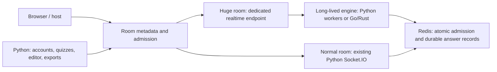

# Investigating 10,000-player rooms

Measured 2026-10-15 in the existing `codex/load-bottleneck-analysis` worktree.
This investigation changes the local benchmark harness only. The normal room
mode, implemented optimization toggle, deployment, and live VM are unchanged.

## What the current implementation can do

After correcting the local proxy configuration, the implemented large-audience
mode connected **10,000 independent players**, retained **30,000/30,000 answers**
over three rounds, and delivered every question result and final result to every
player, with no unexpected disconnects. A random 0–500 ms answer wave took
**7.88–8.08 seconds** to store. Connection capacity is therefore substantially
higher than comfortable synchronized gameplay capacity.

The earlier recommendation remains 1,000 optimized players for short quizzes
under the strict local comfort target. These larger runs do not establish a
production capacity guarantee. See [CAPACITY.md](CAPACITY.md) for that baseline.

The strongest short-run Python prototype completed **100,000/100,000 answers**
and all host/player results over ten rounds at 10,000 players. Cached context,
uvloop and sparse full GC reduced the worst half-second answer wave to
**2.95 seconds**, with last-player question results within **0.92 seconds** and
final results in **1.33 seconds**. It still failed the strict burst comfort
target: answer-phase HTTP p95 was **1.29 seconds**, and the API remained busy on
one core. API peak RSS was approximately **949 MiB**, and the Go generator peaked
around **353 MiB**; RAM was not the immediate constraint in this short run.

With the same experimental runtime and a **0–5 s submission spread**, another
ten-round run retained **100,000/100,000 answers** and delivered all host/player
results. Worst all-stored was **5.44 s**, answer-phase HTTP p95 **34.6 ms**,
average gameplay API CPU **66.3% of one core**, and final delivery **1.22 s**.
This is encouraging evidence for a paced 10,000-player audience without a new
Go/Rust engine. It does not meet the original half-second-burst target, and final
delivery still exceeds the original one-second comfort limit. GC/churn safety
and the real VM must be validated before advertising that capacity.

<!-- SCALE_TABLE -->

| Players | Variant | Answer window | Rounds | Worst all-stored | Last-player question results p95 | Last-player finals | Answer-phase HTTP p95 | Integrity |
| ---: | --- | --- | ---: | ---: | ---: | ---: | ---: | --- |
| 3,000 | Current optimized | 0-500ms | 3 | 1.97 s | 0.65 s | 0.27 s | 0.72 s | pass |
| 5,000 | Current optimized | 0-500ms | 3 | 3.85 s | 0.39 s | 1.22 s | 1.34 s | pass |
| 10,000 | Current optimized | 0-500ms | 3 | 8.08 s | 2.33 s | 1.14 s | 2.69 s | pass |
| 10,000 | uvloop only | 0-500ms | 3 | 7.12 s | 2.23 s | 1.09 s | 2.50 s | pass |
| 10,000 | uvloop + cache (host cap failure) | 0-500ms | 10 | 5.62 s | 2.21 s | 1.31 s | 3.84 s | host cap failure* |
| 10,000 | uvloop + cache + sparse full GC | 0-500ms | 10 | 2.95 s | 0.91 s | 1.33 s | 1.29 s | pass |
| 10,000 | uvloop + cache + sparse full GC | 0-5s | 10 | 5.44 s | 0.96 s | 1.22 s | 0.03 s | pass |

<!-- /SCALE_TABLE -->

All-stored includes question delivery, bot think time and persistence, measured
by an independent Redis poll. It is not an individual answer acknowledgement.
Question/final result timings end when the **last** player receives the payload.
The first three- and five-thousand-player runs had an unrelated busy container
on the PC. Other workloads varied during the later tests too; comparisons are
engineering observations, not clean-room speedup guarantees.

## Measured bottlenecks and proposed remedies

| Bottleneck / evidence | Impact | Proposed remedy | Maturity / trade-offs |
| --- | --- | --- | --- |
| **One busy Python event loop.** At 10,000, answer phases used about 99.5% of one CPU core; Redis used about 11%. A separate 5,000-player cProfile phase spent 3.27 of 6.53 profiled seconds inside asyncio itself (exclusive self time), plus socket and protocol work. | The HTTP API, host controls and all player messages queue behind the same process. Ten thousand connections do not use four CPU cores for Python handlers. | Reduce awaits/messages first; then distribute connections across coordinated workers or an optimized realtime service. uvloop alone was measured and helped modestly. | Runtime tuning is low/medium risk; distributed room ownership is a substantial change. No required feature loss. More workers alone are unsafe without routing and broadcast coordination. |
| **Cyclic garbage collection scans the live connection graph.** Instrumented full collections reached roughly 1.3–1.4 s at 10,000 players, often reclaiming zero objects. | Stop-the-world pauses produce choppy counts and control responses even when average traffic is modest. Faster grading does not address them. | Reduce retained objects/cycles; isolate large rooms; evaluate bounded collection outside active answer windows. The lab also tests sparse full collections to quantify the cost. | GC scheduling is experimental. Deferring collections risks retained cycles and rising memory under churn; short tests cannot certify a safe threshold. Do not simply disable GC globally. |
| **Four Redis round trips per answer.** Session GET, complete quiz JSON GET/decode, active-state HGETALL and atomic commit. At 10,000, Redis sent about 36 MB to the API per answer wave, despite a tiny ten-question quiz. Lua itself averaged about 14–15 microseconds. | Repeated state loading creates socket operations, coroutine wakeups, parsing and allocation on the saturated API core. Redis server execution is not the primary capacity limit in this workload. Long quizzes amplify the JSON cost. | Keep authenticated connection identity and immutable question context locally, versioned by room generation; retain authoritative Lua membership, deadline and deduplication guards. Alternatively publish a small current-question record and pipeline reads. | The single-worker cache is a measured lab prototype. Production needs explicit invalidation, TTLs, reconnect/kick handling and cross-worker tests. No player feature needs removal. |
| **10,000 notifications to one host per answer wave.** The previous all-player quadratic broadcast is already fixed; the remaining host stream is linear. | Additional tasks, frames and browser work, with a host UI unable to meaningfully paint 10,000 intermediate counts. This is a remaining design cost, not proven to dominate CPU. | Coalesce absolute answer counts to 4–10 updates/second and always flush the exact final count on close. Batch roster updates and keep browser rows bounded. | Straightforward, medium implementation risk around final/stale events. Live answer count remains possible, with 100–250 ms update granularity. Individual answer persistence remains immediate. |
| **Personal results and full host history still require linear work.** Optimized phones already receive only their own result/rank plus the final top ten. The host still receives all answer records. | Fanout and host JSON processing grow with N; final history grows with N×questions. Sending one full history to the host can still pause its browser/API at 10,000. | Keep personal results, share small aggregates, send only a paginated host summary, and generate full downloadable history asynchronously. Rank once per reveal. | Medium change. Full export can remain available; inspecting every raw answer synchronously at reveal would be deferred. Headless benchmarks do not certify browser rendering. |
| **Deployment socket/port budgets.** The first 10,000-player attempt stopped at 9,102 joins; nginx logged `Address not available` while opening upstream connections. | The proxy can reject joins before application capacity is reached. Each proxied WebSocket needs client and upstream sockets, and closed short HTTP connections also consume source ports temporarily. | Raise FD/worker-connection budgets, reuse upstream HTTP connections, size TCP/source-port budgets and test every proxy hop, including the outer proxy manager. | Conventional deployment work, no feature loss. Fixed only in the local lab here. A faster engine cannot bypass these limits. |

Grading is **not** the expensive part: the profiled 5,000-answer wave spent only
about **6 ms cumulatively** in `check_question_answer` and `calculate_score`.
Compression of these small gameplay messages was also a minor part of that
profile. Rewriting only those functions cannot provide the required order-of-
magnitude gain. cProfile adds overhead; its timing is separate from capacity
runs, and overlapping asynchronous cumulative durations must not be summed.
GC time can be charged to the allocating function in that profile, so the
asyncio attribution is not a separate cost to add on top of measured GC pauses.

The cache experiment removes two of the four application Redis round trips;
active-state HGETALL and the authoritative Lua commit remain per answer. A next
unmeasured step is to cache the versioned round token/start/deadline as well,
reducing the common path to **one atomic commit**, with Lua still rejecting
closed/replaced rounds and invalid membership. Together with count coalescing,
this should be tested before choosing a rewrite. Its speedup is not established
by the current prototype.

## Would a Go/Rust binary be a good design?

A compiled engine is a reasonable second-stage option for a hard 10,000-player
target, but it should be a **long-lived realtime service that owns the optimized
connections and answer path**, selected when the host creates the room. Spawning
a program per answer adds process startup and IPC to a path whose arithmetic is
already negligible. Sending every message through Python before calling a
compiled helper leaves much of the measured bottleneck in place.

Keep the existing Python application for accounts, quiz editing, storage and
exports. Select one engine owner for the **entire room lifecycle**, covering
join/rejoin/kick, open/close, answer admission, ranking and results. Browser
metadata chooses the realtime endpoint before connecting. The optimized engine
must handle inbound sockets and outbound fanout itself; Python can send infrequent
room-control commands through a versioned protocol. A shared result schema and
golden fixtures for all question types prevent two implementations drifting.

I would first benchmark a coordinated Python worker design with compact state
and controlled GC, after completing the one-commit path and count coalescing,
because it reuses the existing rule implementation. Merely
raising Gunicorn's worker count will not work with the current in-process room
manager: Socket.IO requires cross-process coordination, and polling clients need
session affinity. A room pinned entirely to one worker still has a one-core
limit. Connections within a huge room must actually be distributed to benefit.
These requirements are documented by
[python-socketio](https://python-socketio.readthedocs.io/en/stable/server.html#horizontal-scaling).

If the same burst target still fails, a Go service is a practical next prototype
given the existing Go load tool. Rust is also viable; selecting a correct
Engine.IO v4 / Socket.IO implementation, preserving admission semantics and
owning the full I/O path matter more than choosing between the two languages.
A plain WebSocket rewrite would require a corresponding client protocol change.
Neither language automatically proves 10,000-player capacity on this VM.

The process boundary also matters for the toggle: event-loop selection and GC
policy belong to a process, not one quiz. A dedicated optimized Python worker
can be the first implementation behind that same boundary; replacing it with
Go later need not change the normal engine. The current separate
`large_audience.py` module handles result delivery, not transport ownership.

## Trade-offs I would accept for the single large-audience toggle

- Keep all question types, immediate atomic answer storage, own result/score,
  exact rank, host moderation and connection heartbeats.
- Update the host's live count a few times per second. This preserves a live
  count; it removes individual intermediate count events.
- Keep top ten and personal standings on phones; page host details and defer
  full history/export work outside the live answer path.
- Consider WebSocket-only admission for huge rooms to simplify routing and
  reduce upgrade work. This gives up polling fallback on networks that block
  WebSockets. The runs here retain normal polling/upgrade.
- Keep bounded queues, explicit overload responses and reconnect support. Do not
  silently drop answers or trust client-provided answer timestamps to conceal
  server queueing. Overloaded receive queues can distort speed-based scoring.
- Use HTTP/CDN caching for common static assets and media. For example, a 500 KB
  image fetched by 10,000 players is 5 GB of delivery. That is separate from the
  small realtime answer stream measured here; personalized results cannot be
  safely shared as public cached objects.

These measures do not inherently require removing a live answer count or the
basic quiz mechanics. The central constraint is preserving low queueing delay
and timing fairness during bursts. A five-second spread is a different workload
from 10,000 answers offered in half a second; neither should be advertised as
the other.

The baseline's stored `time_taken` reached roughly 2.6–2.7 s at p95 even though
bot think time was 0–500 ms. Question delivery and server queueing are included
in that value, so this is not a measured network RTT, but it shows why retaining
all answers alone is insufficient for fair speed-based scoring.

## Scope and reproducibility

All six server containers share logical CPUs 0–3, with one API worker, as in the
previous investigation. The generator uses CPUs 4–7. API memory is capped at
2 GiB, proxy at 1 GiB, and the other four services at 1 GiB each. nginx now has
four workers with 16,384 connection slots each and upstream HTTP keepalive;
API and runner FD limits are 65,536. Those lab changes prevent artificial
10,000-player limits; they have not been deployed to the VM.

The generator uses independent identities, normal metadata requests, polling to
WebSocket upgrade, compression, Engine.IO's 25 s interval / 20 s timeout,
time synchronization and randomized answers. Installed Uvicorn uses wsproto;
there is no additional automatic WebSocket ping loop in that implementation.
No heartbeat, validation, membership, deadline or duplicate checks were removed.

`LAB_SCALE=cached-context` is a single-worker measurement prototype with no
cross-worker invalidation. `LAB_WORKER=lab_worker.UVLoopWorker` loads pinned
uvloop 0.22.1 from ignored lab dependencies. Neither flag changes production
source or dependencies. [uvloop](https://github.com/MagicStack/uvloop) replaces
asyncio's event loop using Cython/libuv; it is not a quiz-engine rewrite.
`sparse-full-gc` raises thresholds to `(700, 10, 100000)` while leaving young
collections active. This deliberately defers full collection for a short-run
upper-bound experiment; it needs a memory/churn design before deployment.
The restored default runtime reports `(2000, 10, 10)`: the experiment also uses
a lower young-generation threshold, so it measures that explicit combined
policy, not an isolated change to just the third threshold.

Raw reports, profiles and logs are retained under ignored `results/`.
`scale-measurements.json` records the compact evidence; `scale_report.py` derives
per-phase measurements. Commands are in [README.md](README.md#10000-player-experiments).
The initial proxy-port failure and one transient DNS/readiness failure are
excluded from successful gameplay comparisons and retained as diagnostic runs.
`modes.ps1` now refreshes nginx workers after replacing the API to avoid that
readiness race.
One ten-round cache run retained all 100,000 answers and delivered all player
results, but the controller's host timed out on its approximately 9 MiB answer
history because aiohttp defaults to 4 MiB per incoming message. That run is
marked incomplete, not counted as a clean pass. The controller now permits a
bounded 64 MiB, and subsequent complete runs use that cap. A following run was
interrupted during joins to apply that correction; its partial report is kept.

These are short, synthetic, media-free local runs, not TLS/public-network, long
quiz, browser-rendering, reconnect-storm or soak certification. The CPU is a
Ryzen 9 9900X3D, not the VM CPU. HTTP probes are sequential and under-sample slow
intervals; reported percentiles describe the observed probes. Their final phase
also includes synchronized bot departure. Raw per-phase data distinguishes
answer traffic from teardown. Three-round "p95" is the worst of three rounds,
not a statistically strong population percentile. The previous strict comfort
thresholds have not been relaxed to make 10,000 pass.
